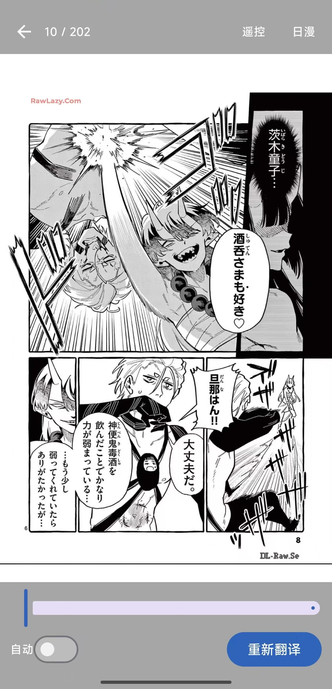
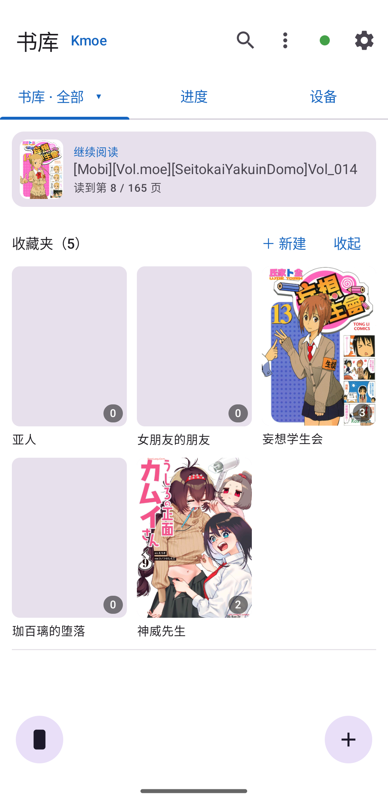
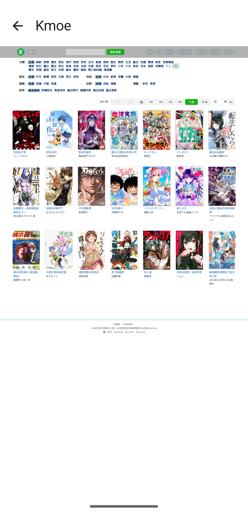
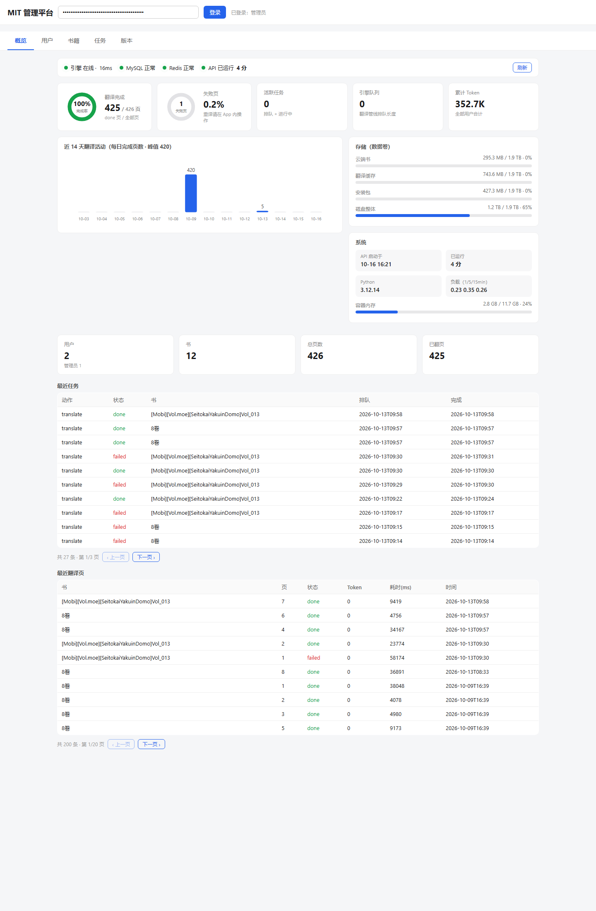

# Manga Image Translator

<div align="center">

**把生肉漫画放进口袋，把翻译引擎放在自己的服务器上。**

Android 漫画阅读器 · 自建翻译后端 · 云端书库 · 多设备进度同步 · 局域网遥控阅读 · 自托管管理平台

[](https://github.com/Dovahlore/manga-raw-reader-app/actions/workflows/ci.yml)
[](https://github.com/Dovahlore/manga-raw-reader-app/releases)
[](android/README.md)
[](LICENSE)

[功能总览](#功能总览) · [翻译效果](#翻译效果) · [管理平台](#管理平台) · [快速开始](#快速开始) · [架构](#架构)

</div>

---

## 翻译效果

检测、OCR、抹字、嵌字、翻译全部在服务端完成——阅读器里单击即可在原图与译文间切换：

| 生肉原文 | 中文译文 |
| :---: | :---: |
|  |  |

## 应用一览

| 书库 · 真实封面与云端书架 | Kmoe 在线书源 | 自托管管理平台 |
| :---: | :---: | :---: |
|  |  |  |

## 这是一个什么项目？

一套可以完全自托管的漫画翻译和阅读系统：

1. 手机 App 导入 EPUB、MOBI、CBZ、CBR、ZIP、RAR 或图片文件夹，也能直接从 Kmoe 在线书源浏览下载；
2. 后端把每页图片交给检测、OCR、抹字、嵌字和翻译模型（OpenAI 兼容接口，DeepSeek 等）；
3. App 在阅读器里直接显示译文页，单击切换译文/原图；
4. 书籍、译文、阅读进度、收藏夹和任务状态同步到你自己的服务器；
5. 多台设备共享同一个书架：平板阅读、手机遥控、局域网免流量对传。

项目 Fork 自 [zyddnys/manga-image-translator](https://github.com/zyddnys/manga-image-translator)，保留并复用其成熟翻译管线，在此之上新增了 Android 阅读器、任务型后端、账号隔离、云同步和设备协作能力。

> **翻译在服务器跑，手机只负责展示和翻页。** 老手机也能阅读复杂页面的大图，不会把电量耗在模型推理上。模型 API Key 只保存在手机本机、随请求临时透传，服务器不落盘。

## 核心亮点

- 📖 **真漫画阅读器**：RTL 日漫模式、LTR 普通模式、缩放平移、边缘翻页、译文/原图一键切换、音量键翻页。
- 🧠 **完整翻译管线**：文字检测、OCR、气泡分割、背景修复、译文排版在服务端完成；App 可随时切换 OpenAI 兼容模型、Base URL 和 API Key。
- ☁️ **自托管云书库**：一个 API Key 就是一个账号，不同 Key 的书架完全隔离；按内容 hash 识别同一本书，换机续读。
- 📶 **局域网设备协作**：NSD 自动发现、分片断点续传、SHA-256 校验传书；6 位配对码 + 失败锁定防爆破，双向配对凭据并存，遥控会话每次弹窗确认。
- 🛠️ **自托管管理平台**：`/dashboard` 一页看全引擎健康、存储、14 天翻译活动、用户/书籍/任务，版本发布台直接上传 APK 管理更新。
- 🧱 **App 级任务系统**：扫描、导入、同步、全书翻译、下载和搬运不因离开页面而中断，进程重启自动恢复。
- 💾 **存储无忧**：内部存储 / SD 卡任选；SD 缺席时自动拒绝写入保护书库，索引损坏自动从备份恢复。

## 功能总览

| 能力 | 说明 |
| --- | --- |
| 导入格式 | EPUB、MOBI/AZW（流式解析，上限 500MB）、CBZ、CBR、ZIP、RAR、单层图片文件夹 |
| 在线书源 | 内置 Kmoe 浏览下载（分类/搜索/分页） |
| 去重 | 源文件 SHA-256、页内容 hash、页面指纹，防止重复入库和重复翻译 |
| 书库视图 | 网格/列表、本地/云端筛选、搜索、排序、收藏夹、继续阅读、状态角标 |
| 阅读方向 | 日漫 RTL、普通 LTR，逻辑页码与视觉方向解耦 |
| 阅读手势 | 双击放大、双指缩放、单指平移、惯性滑动、边缘外滑翻页、底部菜单热区 |
| 单页翻译 | 当前页手动翻译，已完成页可强制重翻；自动预翻后 3 页 |
| 全书翻译 | App 级后台队列，可停止、可恢复、崩溃后按服务端页状态续跑、失败页明细 |
| 翻译上下文 | 默认携带前 3 页译文，按真实页码分块，避免多页文字混淆 |
| 云同步 | 原书包、页面索引、译文状态、收藏夹、阅读进度（最后写入者胜） |
| 设备对传 | 同局域网免流量传书，断点续传 + 逐文件校验 + 原子导入 |
| 遥控器 | 配对码防爆破锁定；凭据 30 天有效期；双向配对互不顶掉；每次遥控会话弹窗确认（协议级意图识别，秒级弹窗）；断开 60 秒冷却；单侧取消自动清理对端记录 |
| 自动更新 | 后端维护 APK 发布表，App 内检查、下载、sha256 校验并安装 |
| 存储位置 | 内部存储 / 机身共享存储 / SD 卡，旧位置可搬运，书库聚合显示 |
| 管理平台 | 管理员 Key 登录 `/dashboard`：概览/用户/书籍/任务/版本发布台五页 |

## 阅读器细节

- 翻到已翻译页时直接显示译文，不先闪原图。
- 菜单隐藏时，单击图片切换译文/原文；双击放大或复位；点底部热区呼出菜单。
- 放大后图片 1:1 跟手平移，滑到边缘继续外滑可翻页。
- 阅读进度本地立即保存，防抖同步到云端；全书翻译进行中会周期性补拉新完成的译文页。

## 云同步与离线策略

- **云端保存**：原书包、页面索引、任务状态、翻译结果、收藏夹、阅读进度。
- **识别同一本书**：优先内容 hash，兼容云端书 ID，同一本书不同来源导入不重复。
- **离线**：本地书完整可读；云端书列表与进度保留最后一次在线快照；仅云端书离线时明确拦截下载。
- **重新联网**：后台同步用服务器最新状态覆盖本地快照。

## 遥控与设备对传

两台装了本 App 的设备在同一局域网内：

- **传书**：书卡菜单「分享/对传」，NSD 自动发现或手动 IP 连接，分片断点续传、逐文件 SHA-256 校验、导入原子化。
- **遥控**：设备页输 6 位配对码配对（连续错 5 次指数锁定）；遥控请求以协议级意图标识，被控端秒级弹窗确认，每次会话都要确认；断开后 60 秒冷却防打扰；任何一单侧「忘记」立即吊销凭据并自动清理对端记录。

## 管理平台

服务端自带一个零依赖的单文件管理台（`/dashboard`，管理员 Key 登录）：

- **概览**：引擎探活与延迟、MySQL/Redis 健康、API 运行时长、存储/内存/磁盘、14 天每日完成页数柱状图、完成率与失败页。
- **用户**：列表、改名、授予/撤销管理员、删除（级联清云端书/任务/收藏夹，不吊销 Key）。
- **书籍 / 任务**：跨用户书籍与失败页明细、活跃/失败任务与取消。
- **版本发布台**：拖拽上传 APK 即发布（version_code 渠道 ABI 完整可控）、上下架、更新模拟。

按约定，管理平台只做检测与监控：**不触发翻译、不保存任何模型 API Key**，重译一律在手机 App 内完成。

## 架构

```text
┌────────────────────────────┐
│ Android App (Kotlin/Compose) │
│ 阅读器 · 书库 · Kmoe · 遥控器 │
└────────────┬───────────────┘
             │ HTTP / JSON / Multipart
             ▼
┌────────────────────────────┐
│ app-api (FastAPI, :8020)    │
│ 账号 · 任务 · 云同步 · 管理台 │
└──┬──────────┬──────────┬───┘
   │          │          │
   ▼          ▼          ▼
 MySQL       Redis      Disk
 元数据/进度  结果缓存   原图/译文/云端书
                          │
                          ▼
              ┌────────────────────┐
              │ translation engine │
              │ 检测 · OCR · 修复 · 嵌字 │
              └────────────────────┘
```

## 快速开始

### 1. 准备服务器

- NVIDIA GPU 与可用的 CUDA Runtime；
- Docker Desktop 或 Docker Engine；
- 足够存放模型与书页的磁盘空间；
- Android 设备与服务器在同一局域网；公网访问建议使用 VPN 或 HTTPS 反代。

### 2. 启动后端

```bash
git clone https://github.com/Dovahlore/manga-raw-reader-app.git
cd manga-image-translator

cp app.env.example app.env
# 编辑 app.env：设置数据库密码、Redis 密码和 MIT_API_TOKEN

touch secret.env   # 可留空；翻译模型 Key 只保存在 Android App

docker compose --env-file app.env -f docker-compose.full.yml up -d
```

首次启动会下载模型和镜像。检查服务：

```bash
docker compose --env-file app.env -f docker-compose.full.yml ps
curl http://127.0.0.1:8020/v1/app/update
```

### 3. 构建 Android App

```bash
cd android
gradle assembleRelease --no-daemon
```

Windows 环境也可以按 [android/README.md](android/README.md) 使用 JDK 17、Android SDK 和 Gradle 8.7 构建。

### 4. 连接 App 与服务器

1. 安装 APK；
2. 打开 App「设置 → 服务器」，地址填 `http://<服务器局域网IP>:8020`，API Key 填 `app.env` 里的 `MIT_API_TOKEN`，点「测试连接」；
3. 「设置 → 翻译」填写模型名、API Base URL 和模型 API Key（例如 `deepseek-v4-pro` + `https://api.deepseek.com`），Key 只保存在手机本机。

> 不要把真实 API Key 写进 README、截图或 Issue。

## 配置速查

| 配置 | 说明 |
| --- | --- |
| `MIT_API_TOKEN` | App API Key；支持逗号分隔多账号；留空则不鉴权，仅建议隔离内网使用 |
| `MIT_TRANSLATOR` | 默认翻译器，例如 `deepseek` |
| `MIT_TARGET_LANG` | 默认目标语言，例如 `CHS` |
| `MIT_CONTEXT_PAGES` | 跨页上下文页数 |
| `MIT_CACHE_TTL` | 结构化结果缓存 TTL，`0` 表示永不过期 |
| `MIT_IMAGE_COMPRESS` | 译文图 WebP 压缩开关 |
| `MIT_RUNTIME` | 运行期数据目录 |
| `MIT_APP_PORT` / `MIT_WEB_PORT` | app-api / 引擎 Web 端口 |

更多变量见 [`app.env.example`](app.env.example)。

## 安全建议

- 公网部署必须开启 `MIT_API_TOKEN`，并使用 HTTPS 反代或 VPN。
- 为 MySQL 和 Redis 设置强密码，不要把数据库端口暴露到公网。
- `app.env`、`secret.env`、签名密钥不要提交到 Git。
- 多用户场景使用不同 API Key，数据按 Key 隔离；管理平台用管理员 Key 登录。
- 云端书和翻译结果存放在服务器运行期目录，请自行备份。

## 项目结构

```text
android/                    Android App
app_api/                    FastAPI 服务层：账号、任务、云同步、管理平台、自动更新
manga_translator/           翻译管线：检测、OCR、修复、嵌字、上色、超分
server/                     引擎 HTTP 服务
docker-compose.full.yml     engine + app-api + MySQL + Redis
docker-compose.tunnel.yml   可选 frp 隧道
dict/                       术语表与替换字典
```

## 文档

- [Android App 说明](android/README.md)
- [后端 API 速查](app_api/API.md)
- [Docker 部署](DOCKER_SETUP.md)
- [更新日志](CHANGELOG.md)

## 开发路线

- [ ] 阅读器页面预取策略调优
- [ ] 更完整的译文校对工作台
- [ ] 局域网传输加密（TLS/预共享密钥）
- [ ] 自动备份与恢复向导

## 贡献

欢迎 Issue 和 PR。提交前请：保持改动聚焦；不提交密钥、模型、运行期数据和私人书籍；Kotlin / Python 代码尽量遵循现有风格。

## 许可证

[GPL-3.0](LICENSE)

## 致谢

本项目基于 [zyddnys/manga-image-translator](https://github.com/zyddnys/manga-image-translator) 继续开发，感谢上游作者和所有模型、依赖项目的贡献者。

<div align="center">

如果这个项目让你的漫画阅读更轻松，欢迎点一个 Star ⭐

</div>
